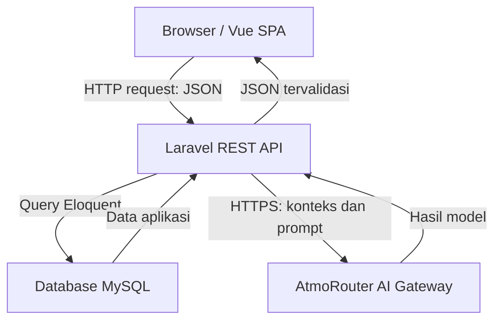
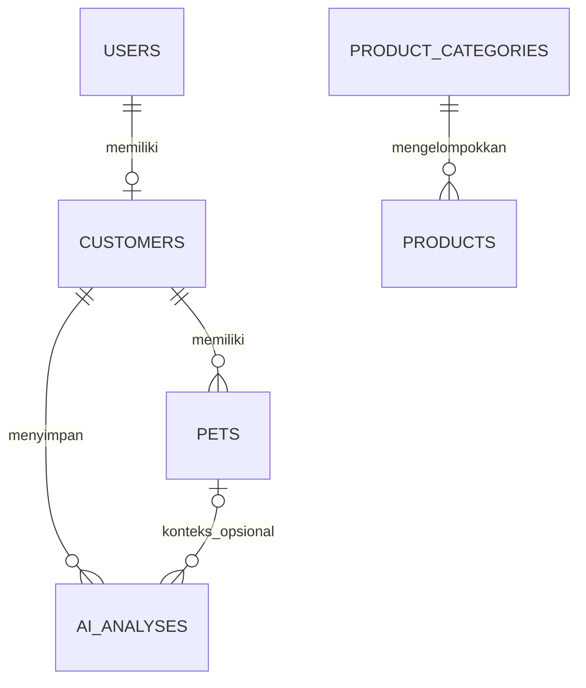

# PetShop AI — Sistem Informasi Pet Shop Berbasis AI

Sistem informasi berbasis web untuk menampilkan katalog produk dan layanan pet shop serta membantu pengguna memahami kebutuhan hewan melalui **AI Pet Assistant**. Aplikasi menggunakan frontend Vue dan backend Laravel yang berkomunikasi melalui REST API. Permintaan AI dikirim dari backend ke AI Gateway AtmoRouter.

Proyek ini dikembangkan sebagai tugas mata kuliah **Komunikasi Data**, Program Studi Teknologi Informasi, Politeknik Sampit.

| Informasi | Keterangan |
| --- | --- |
| Pengembang | Bayu Nanda Pamungkas |
| Nama aplikasi | PetShop AI |
| Backend | Laravel / PHP |
| Frontend | Vue 3, Vite, Vue Router, Axios |
| Database | MySQL pada lingkungan pengembangan Laragon |
| AI Gateway | AtmoRouter |
| Lingkungan pengembangan | Windows, Laragon, VS Code, PowerShell |
| Status | Fitur utama telah berfungsi pada lingkungan lokal berdasarkan pengujian pengguna |
| Pembaruan dokumentasi | 4 Oktober 2026 |

## Daftar isi

- [Latar belakang dan tujuan](#latar-belakang-dan-tujuan)
- [Ruang lingkup](#ruang-lingkup)
- [Pengguna dan fitur](#pengguna-dan-fitur)
- [Arsitektur dan komunikasi data](#arsitektur-dan-komunikasi-data)
- [Struktur proyek](#struktur-proyek)
- [Relasi data utama](#relasi-data-utama)
- [Persiapan lingkungan](#persiapan-lingkungan)
- [Instalasi backend](#instalasi-backend)
- [Konfigurasi ai gateway](#konfigurasi-ai-gateway)
- [Instalasi frontend](#instalasi-frontend)
- [Menjalankan aplikasi](#menjalankan-aplikasi)
- [Daftar endpoint api](#daftar-endpoint-api)
- [Cara menggunakan aplikasi](#cara-menggunakan-aplikasi)
- [Cara kerja ai pet assistant](#cara-kerja-ai-pet-assistant)
- [Tahapan pengembangan](#tahapan-pengembangan)
- [Pengujian](#pengujian)
- [Pemecahan masalah](#pemecahan-masalah)
- [Batasan dan pengembangan berikutnya](#batasan-dan-pengembangan-berikutnya)
- [Panduan demonstrasi](#panduan-demonstrasi)
- [Referensi](#referensi)

## Latar belakang dan tujuan

Informasi produk dan layanan pet shop perlu disajikan secara terpusat agar pelanggan dapat mengetahui pilihan yang tersedia tanpa harus bertanya satu per satu. Pemilik hewan juga sering memerlukan arahan awal mengenai perawatan atau keluhan hewannya.

PetShop AI menggabungkan katalog informasi dengan asisten AI. Pengunjung dapat melihat katalog dan menggunakan AI tanpa login. Akun customer menjadi pilihan tambahan untuk menyimpan profil, data hewan, dan riwayat analisis.

Tujuan proyek:

1. Menyediakan katalog produk dan layanan yang dapat dikelola admin.
2. Membantu pengguna menemukan layanan yang relevan dengan kebutuhan hewan.
3. Memberikan informasi kesehatan awal berupa kemungkinan penyebab, urgensi, dan langkah selanjutnya.
4. Memisahkan akses admin dan customer.
5. Menerapkan komunikasi data antara browser, REST API, database, dan layanan AI eksternal.

## Ruang lingkup

Sistem berfokus pada **katalog informasi dan integrasi AI**. Harga pada katalog berfungsi sebagai informasi.

Fitur transaksi penjualan, keranjang, checkout, pembayaran, booking, dan reservasi grooming tidak termasuk dalam ruang lingkup proyek ini.

AI kesehatan memberikan informasi awal dengan ketidakpastian. Hasilnya bukan diagnosis pasti dan tidak menggantikan pemeriksaan dokter hewan.

## Pengguna dan fitur

| Fitur | Guest | Customer | Admin |
| --- | --- | --- | --- |
| Melihat katalog produk dan layanan | Ya | Ya | Ya |
| Menggunakan analisis AI publik | Ya | Ya | Ya |
| Dashboard customer | — | Ya | — |
| Mengelola profil customer | — | Ya | — |
| Mengelola data hewan sendiri | — | Ya | — |
| Analisis AI dengan konteks hewan dan penyimpanan riwayat | — | Ya | — |
| Melihat riwayat analisis sendiri | — | Ya | — |
| Dashboard admin | — | — | Ya |
| Mengelola kategori, produk, dan layanan | — | — | Ya |
| Melihat data customer | — | — | Ya |
| Monitoring analisis AI customer yang tersimpan | — | — | Ya |

### Halaman publik

- Beranda sebagai pintu masuk aplikasi.
- Katalog produk beserta informasi detailnya.
- Katalog layanan beserta informasi detailnya.
- AI Pet Assistant dengan formulir pertanyaan dan hasil analisis.
- Login dan pendaftaran akun customer.

### Dashboard customer

- Menampilkan informasi dashboard pelanggan.
- Mengelola profil.
- Menambah, melihat, mengubah, dan menghapus data hewan milik sendiri.
- Memilih hewan saat menggunakan AI.
- Melihat riwayat dan detail analisis yang tersimpan.

### Dashboard admin

- Menampilkan statistik produk, kategori, layanan, dan customer.
- Mengelola kategori produk, produk, serta layanan.
- Melihat daftar dan detail customer.
- Memantau analisis AI yang tersimpan beserta metadata model dan token jika tersedia dari gateway.

### Pembaruan halaman AI Assistant

- Panel ringkasan dan kategori analisis.
- Informasi tingkat kebutuhan serta urgensi untuk pertanyaan kesehatan.
- Kemungkinan penyebab awal beserta penjelasannya.
- Pertanyaan klarifikasi dan langkah selanjutnya.
- Rekomendasi layanan yang sesuai untuk pertanyaan perawatan atau katalog.
- Tombol **Kembali** di kiri atas: kembali melalui history Vue Router, atau menuju beranda `/` jika tidak ada halaman sebelumnya dalam aplikasi.

## Arsitektur dan komunikasi data



Frontend bertanggung jawab atas tampilan, navigasi, formulir, loading, dan pesan kesalahan. Backend menjalankan validasi, autentikasi, pemeriksaan role dan kepemilikan data, akses database, serta komunikasi dengan AI Gateway.

**Alur permintaan AI:**

1. Pengguna mengisi pertanyaan; customer dapat memilih hewan miliknya.
2. Vue mengirim pertanyaan ke endpoint guest atau customer.
3. Laravel memvalidasi input dan, pada alur customer, memeriksa kepemilikan hewan.
4. Backend mengambil layanan aktif dari database.
5. `AiGatewayService` mengirim aturan sistem dan konteks pertanyaan ke AtmoRouter.
6. Respons AI diperiksa format JSON, tipe data, enum, dan rekomendasi layanannya.
7. Pada alur customer, hasil disimpan dalam riwayat.
8. Backend mengirim respons JSON untuk ditampilkan frontend.

API key hanya digunakan di backend. Frontend tidak memanggil AtmoRouter secara langsung.

## Struktur proyek

Proyek ditempatkan dalam dua folder utama, `backend` dan `frontend`. Tabel berikut menunjukkan lokasi penting; nama view lain mengikuti berkas dalam proyek.

| Lokasi | Fungsi |
| --- | --- |
| `backend/app/Http/Controllers/` | Controller autentikasi, katalog, customer, admin, dan AI |
| `backend/app/Http/Controllers/AiController.php` | Analisis guest/customer, riwayat, dan monitoring |
| `backend/app/Http/Middleware/` | Pembatasan akses berdasarkan role |
| `backend/app/Models/` | Model dan relasi database |
| `backend/app/Services/AiGatewayService.php` | Permintaan gateway, prompt, validasi dan normalisasi hasil AI |
| `backend/config/services.php` | Konfigurasi layanan eksternal termasuk AtmoRouter |
| `backend/routes/api.php` | Definisi REST API dan middleware |
| `backend/database/migrations/` | Struktur serta perubahan database |
| `backend/database/seeders/` | Data awal sesuai seeder proyek |
| `backend/tests/Feature/AiHealthAnalysisTest.php` | Pengujian kontrak analisis AI menggunakan gateway tiruan |
| `backend/.env` | Konfigurasi lokal dan rahasia backend |
| `frontend/src/views/` | Halaman aplikasi |
| `frontend/src/views/AiAssistantView.vue` | Formulir dan hasil AI Assistant |
| `frontend/src/layouts/` | Layout aplikasi |
| `frontend/src/router/` | Navigasi halaman Vue Router |
| `frontend/src/services/api` | Konfigurasi Axios; ekstensi berkas mengikuti proyek |
| `frontend/src/services/auth` | State dan utilitas autentikasi; ekstensi mengikuti proyek |
| `frontend/package.json` | Dependensi dan script frontend |
| `README.md` | Dokumentasi pada folder utama proyek |

## Relasi data utama

Entitas domain meliputi akun pengguna, profil customer, hewan, kategori produk, produk, layanan, dan analisis AI. Diagram berikut menjelaskan relasi domain utama; definisi kolom, nama tabel fisik, dan aturan penghapusan mengikuti migration proyek.



Layanan menjadi sumber rekomendasi AI. Daftar rekomendasi disimpan dalam hasil analisis, sehingga tidak digambarkan sebagai foreign key tunggal ke layanan.

Analisis customer dapat memiliki `pet_id` kosong jika tidak memilih hewan. Pembaruan kesehatan menambahkan kolom JSON nullable `health_details` pada tabel model `AiAnalysis` untuk menyimpan detail tambahan tanpa menghapus riwayat lama.

## Persiapan lingkungan

Siapkan PHP dan Composer, Node.js dan npm, MySQL, serta editor kode. Laragon dapat digunakan untuk lingkungan backend lokal pada Windows.

Gunakan versi PHP dan Node.js yang memenuhi kebutuhan `backend/composer.json` serta `frontend/package.json`. Versi paket yang terpasang dirujuk dari `composer.lock` dan `package-lock.json`; dokumentasi ini tidak menetapkan versi yang belum diverifikasi dari berkas tersebut.

Periksa terminal:

```powershell
php -v
composer --version
node -v
npm -v
```

Jika perintah tidak dikenali, periksa PATH atau gunakan terminal Laragon, kemudian buka ulang terminal. Aktifkan MySQL sebelum menjalankan migration. Internet dan konfigurasi gateway yang valid diperlukan untuk analisis AI langsung.

## Instalasi backend

Petunjuk ini untuk **salinan kode proyek yang sudah tersedia**. Membuat Laravel kosong saja tidak menyediakan controller, migration, dan fitur PetShop AI.

### 1. Masuk ke folder backend

Contoh lokasi pengembangan:

```powershell
cd D:\PEMROGRAMAN_WEB2_SEMESTER5\petshop_ai_tugas\backend
composer install
```

Untuk repository dengan `composer.lock`, gunakan `composer install` agar dependensi mengikuti lockfile.

### 2. Siapkan environment

Pada instalasi baru, salin `.env.example` jika `.env` belum ada:

```powershell
Copy-Item .env.example .env
php artisan key:generate
```

Pada proyek yang sudah berjalan, pertahankan `.env` dan `APP_KEY` yang ada.

Contoh konfigurasi lokal berikut perlu disesuaikan dengan database milikmu:

```dotenv
APP_NAME="PetShop AI"
APP_ENV=local
APP_DEBUG=true
APP_URL=http://127.0.0.1:8000

DB_CONNECTION=mysql
DB_HOST=127.0.0.1
DB_PORT=3306
DB_DATABASE=petshop_ai_tugas
DB_USERNAME=root
DB_PASSWORD=
```

`petshop_ai_tugas` merupakan contoh nama database. Buat database tersebut terlebih dahulu melalui pengelola database, atau ganti dengan nama database proyek yang sudah ada. Pertahankan konfigurasi session, cache, dan queue sesuai `.env.example` proyek.

### 3. Jalankan migration

```powershell
php artisan optimize:clear
php artisan migrate
php artisan migrate:status
```

Migration terakhir untuk detail kesehatan:

```text
2026_10_04_120000_add_health_details_to_ai_analyses_table.php
```

Untuk pembaruan proyek yang sudah berisi data, gunakan `migrate`. `migrate:fresh` menghapus tabel dan tidak diperlukan untuk memasang pembaruan ini.

### 4. Data awal dan akun admin

Periksa `database/seeders/DatabaseSeeder.php` serta seeder yang dipanggil sebelum menjalankan:

```powershell
php artisan db:seed
```

Jalankan jika seeder memang disiapkan untuk data awal proyek. Gunakan akun admin sesuai seeder atau akun admin yang telah dibuat. README ini tidak menetapkan email dan password admin bawaan karena nilai tersebut perlu mengikuti kode aktual. Pendaftaran publik ditujukan untuk customer.

### 5. File gambar

Jika katalog menggunakan file pada disk `public`, buat symbolic link:

```powershell
php artisan storage:link
```

## Konfigurasi AI Gateway

Service membaca konfigurasi berikut dari `config/services.php`:

| Key konfigurasi | Fungsi |
| --- | --- |
| `services.atmorouter.base_url` | Alamat API gateway |
| `services.atmorouter.key` | API key backend |
| `services.atmorouter.model` | Model yang digunakan |
| `services.atmorouter.timeout` | Batas waktu permintaan dalam detik |

Contoh pemetaan, **jika belum tersedia**: tambahkan key `atmorouter` ke array konfigurasi yang ada tanpa menghapus konfigurasi layanan lain.

```php
'atmorouter' => [
    'base_url' => env('ATMOROUTER_BASE_URL', 'https://atmorouter.dev/v1'),
    'key' => env('ATMOROUTER_API_KEY'),
    'model' => env('ATMOROUTER_MODEL'),
    'timeout' => (int) env('ATMOROUTER_TIMEOUT', 30),
],
```

Isi `.env` backend sesuai akun dan model gateway yang tersedia:

```dotenv
ATMOROUTER_BASE_URL=https://atmorouter.dev/v1
ATMOROUTER_API_KEY=isi_api_key_anda
ATMOROUTER_MODEL=isi_model_yang_digunakan
ATMOROUTER_TIMEOUT=30
```

Jika proyek memiliki nama variabel environment berbeda, ikuti pemetaan yang sudah ada di `config/services.php`. Service mengirim POST ke `{base_url}/chat/completions`. Setelah mengubah konfigurasi:

```powershell
php artisan optimize:clear
```

Jangan menyimpan API key dalam source frontend atau memasukkannya ke Git. Nilai environment frontend dapat ikut terbaca dalam bundle browser.

## Instalasi frontend

Buka terminal pada folder frontend:

```powershell
cd D:\PEMROGRAMAN_WEB2_SEMESTER5\petshop_ai_tugas\frontend
npm install
```

Jika ada `package-lock.json` yang konsisten dan ingin instalasi bersih sesuai lockfile, gunakan `npm ci` sebagai pengganti `npm install`.

Periksa konfigurasi Axios pada `src/services/api`. Base URL perlu menunjuk ke:

```text
http://127.0.0.1:8000/api
```

Jika kode membaca environment, gunakan nama variabel yang benar-benar dibaca oleh service tersebut. Contohnya, `VITE_API_BASE_URL` hanya berlaku apabila kode memang memakai `import.meta.env.VITE_API_BASE_URL`. Jangan mengasumsikan penambahan variabel saja otomatis mengubah base URL.

Sesuaikan CORS backend dengan origin frontend dan mekanisme autentikasi yang dipakai. Gunakan host lokal secara konsisten agar konfigurasi autentikasi tidak berbeda antara `localhost` dan `127.0.0.1`.

## Menjalankan aplikasi

Jalankan backend dan frontend dalam **dua terminal terpisah**.

Terminal backend:

```powershell
cd D:\PEMROGRAMAN_WEB2_SEMESTER5\petshop_ai_tugas\backend
php artisan serve
```

Terminal frontend:

```powershell
cd D:\PEMROGRAMAN_WEB2_SEMESTER5\petshop_ai_tugas\frontend
npm run dev
```

| Komponen | Alamat lokal |
| --- | --- |
| Website | `http://localhost:5173/` atau URL yang dicetak Vite |
| Backend | `http://127.0.0.1:8000/` |
| Status API | `http://127.0.0.1:8000/api/status` |

Contoh respons status proyek:

```json
{
  "success": true,
  "message": "Pet Shop API berhasil terhubung",
  "application": "Pet Shop AI",
  "backend": "Laravel"
}
```

Pemeriksaan build frontend:

```powershell
npm run build
```

Build menghasilkan aset frontend; backend dan database tetap harus berjalan terpisah. Pengembangan lokal yang berhasil belum berarti aplikasi telah di-deploy ke server produksi.

## Daftar endpoint API

Daftar berikut mengikuti route proyek yang dibagikan. Base URL lokal: `http://127.0.0.1:8000/api`. Parameter `{...}` diganti dengan ID data yang sesuai.

### Publik dan autentikasi

| Method | Path | Fungsi / akses |
| --- | --- | --- |
| GET | `/status` | Status backend, publik |
| GET | `/categories` | Daftar kategori, publik |
| GET | `/categories/{category}` | Detail kategori, publik |
| GET | `/products` | Katalog produk, publik |
| GET | `/products/{product}` | Detail produk, publik |
| GET | `/services` | Katalog layanan, publik |
| GET | `/services/{service}` | Detail layanan, publik |
| POST | `/ai/analyze` | Analisis AI tanpa penyimpanan riwayat customer, publik |
| POST | `/register` | Pendaftaran customer, publik |
| POST | `/login` | Login, publik |
| POST | `/logout` | Logout, `auth:sanctum` |
| GET | `/me` | Pengguna aktif, `auth:sanctum` |

### Customer — `auth:sanctum` dan `CustomerMiddleware`

| Method | Path | Fungsi |
| --- | --- | --- |
| GET | `/customer/dashboard` | Dashboard customer |
| GET / PUT | `/customer/profile` | Melihat / memperbarui profil |
| GET / POST | `/customer/pets` | Daftar / tambah hewan |
| GET / PUT / DELETE | `/customer/pets/{pet}` | Detail / ubah / hapus hewan sendiri |
| POST | `/customer/ai/analyze` | Analisis dengan konteks hewan opsional dan penyimpanan riwayat |
| GET | `/customer/ai/history` | Riwayat analisis sendiri |
| GET | `/customer/ai/history/{analysis}` | Detail riwayat sendiri |

### Admin — `auth:sanctum` dan `AdminMiddleware`

| Method | Path | Fungsi |
| --- | --- | --- |
| GET | `/admin/dashboard` | Statistik dashboard |
| POST | `/admin/categories` | Tambah kategori |
| PUT / DELETE | `/admin/categories/{category}` | Ubah / hapus kategori |
| GET / POST | `/admin/products` | Daftar admin / tambah produk |
| PUT / DELETE | `/admin/products/{product}` | Ubah / hapus produk |
| GET / POST | `/admin/services` | Daftar admin / tambah layanan |
| PUT / DELETE | `/admin/services/{service}` | Ubah / hapus layanan |
| GET | `/admin/customers` | Daftar customer |
| GET | `/admin/customers/{customer}` | Detail customer |
| GET | `/admin/ai/monitoring` | Monitoring analisis AI tersimpan |

Admin dapat memakai endpoint kategori publik untuk membaca daftar kategori. Daftar route di atas tidak mencantumkan GET `/admin/categories` karena route tersebut tidak ada pada daftar yang diverifikasi.

Untuk memeriksa route pada salinan proyek yang dijalankan:

```powershell
php artisan route:list -v --path=api
```

## Cara menggunakan aplikasi

### Guest

1. Buka beranda, lalu lihat katalog produk atau layanan.
2. Buka halaman `/ai-assistant`.
3. Tulis pertanyaan lengkap dan kirim analisis.
4. Baca ringkasan, rekomendasi, atau informasi kesehatan yang diberikan.
5. Klik **Kembali** untuk menuju halaman sebelumnya.

Guest tidak perlu membuat akun. Analisis melalui endpoint publik tidak disimpan sebagai riwayat customer.

### Customer

1. Daftar atau login sebagai customer.
2. Lengkapi profil dan masukkan data hewan pada dashboard customer.
3. Buka AI Assistant dan pilih hewan jika ingin menyertakan konteksnya.
4. Kirim pertanyaan; analisis tersimpan pada riwayat customer.
5. Buka riwayat untuk melihat analisis terdahulu.

Data hewan yang digunakan sebagai konteks dapat meliputi nama, jenis, ras, jenis kelamin, tanggal lahir, berat, dan catatan sesuai data yang tersedia.

### Admin

1. Login menggunakan akun admin proyek.
2. Buka dashboard admin.
3. Kelola kategori, produk, dan layanan.
4. Pastikan layanan yang ingin direkomendasikan AI berada dalam status aktif.
5. Tinjau data customer dan monitoring analisis AI tersimpan.

## Cara kerja AI Pet Assistant

### Jenis analisis

| `analysis_type` | Cakupan | Perilaku |
| --- | --- | --- |
| `health` | Gejala atau pertanyaan kesehatan hewan | Informasi awal, kemungkinan penyebab jika cukup data, urgensi, dan langkah berikutnya |
| `care` | Perawatan rutin tanpa gejala penyakit | Rekomendasi layanan relevan dari katalog aktif |
| `catalog` | Ketersediaan layanan atau informasi produk | Jawaban sesuai konteks katalog; tidak mengarang informasi yang tidak diberikan |
| `out_of_scope` | Pertanyaan di luar hewan peliharaan/pet shop | Penjelasan singkat cakupan sistem tanpa rekomendasi |

### Format permintaan

Guest, POST `/api/ai/analyze`:

```json
{
  "question": "Kucing saya sehat, tetapi bulunya kotor. Adakah layanan perawatan yang sesuai?"
}
```

Customer, POST `/api/customer/ai/analyze`, memakai autentikasi aplikasi:

```json
{
  "question": "Kucing saya beberapa hari sering muntah, lemas, dan nafsu makannya menurun. Apa kemungkinan penyebab dan langkah berikutnya?",
  "pet_id": 1
}
```

Ganti ID `1` dengan ID hewan milik customer yang sedang login. Customer boleh tidak memilih hewan. Memakai ID hewan akun lain ditolak sebelum gateway dipanggil.

### Struktur hasil

| Field dalam `data` | Isi |
| --- | --- |
| `is_relevant` | Relevansi pertanyaan terhadap cakupan aplikasi |
| `analysis_type` | Jenis analisis |
| `category` | Kategori hasil |
| `need_level` | `Ringan`, `Sedang`, atau `Tinggi` |
| `summary` | Ringkasan hasil |
| `recommended_services` | Daftar rekomendasi layanan yang cocok dari katalog |
| `safety_note` | Catatan batasan dan arahan yang relevan |
| `possible_causes` | Daftar objek `name` dan `explanation` |
| `urgency` | Objek `level`, `reason`, dan `action` |
| `follow_up_questions` | Informasi tambahan yang perlu dilengkapi |
| `next_steps` | Langkah berikutnya |

Metadata `ai` pada respons memuat informasi gateway, model, dan penggunaan token sesuai respons provider. Pada analisis customer, respons juga menyertakan `analysis_id` dan konteks hewan.

### Urgensi kesehatan

| Nilai | Makna |
| --- | --- |
| `monitor` | Pantau keluhan ringan dan perhatikan perubahan kondisi |
| `vet_soon` | Perlu pemeriksaan dokter hewan dalam waktu dekat |
| `urgent` | Perlu menghubungi atau membawa hewan ke dokter hewan segera |
| `not_applicable` | Pertanyaan bukan analisis kesehatan |

Untuk analisis kesehatan, service memetakan urgensi ke tingkat kebutuhan: `monitor` → `Ringan`, `vet_soon` → `Sedang`, `urgent` → `Tinggi`.

### Aturan hasil dan penyimpanan

- Aturan sistem dipisahkan dari data pertanyaan, hewan, dan katalog dalam pesan permintaan model.
- Respons diperiksa agar memenuhi struktur yang diharapkan.
- Rekomendasi layanan dibatasi pada ID layanan aktif yang benar-benar tersedia.
- Untuk pertanyaan kesehatan, rekomendasi layanan dikosongkan agar grooming tidak ditawarkan sebagai pengganti pemeriksaan.
- Katalog layanan kosong tidak menghentikan analisis kesehatan.
- Model diarahkan menyampaikan kemungkinan dengan ketidakpastian, tanpa diagnosis pasti, obat, dosis, atau persentase kemungkinan penyakit.
- Detail kesehatan disimpan pada `health_details`, sedangkan field lama tetap menggunakan kolom lama.
- Riwayat lama tetap dapat dibaca walaupun belum memiliki detail tambahan.
- Endpoint riwayat mengembalikan detail baru. Panel kesehatan lengkap pada pembaruan ini tersedia di halaman AI Assistant; tampilan halaman riwayat mengikuti implementasinya sendiri.

Validasi format respons tidak menjamin kebenaran isi AI. Jenis analisis dan kemungkinan penyebab masih ditentukan model.

### Pertanyaan lanjutan

Sistem saat ini menganalisis **satu pertanyaan per request**, belum menyertakan konteks percakapan beberapa putaran secara otomatis.

Jika ingin menjawab pertanyaan klarifikasi, kirim kembali pertanyaan lengkap beserta informasi baru. Contoh:

> Kucing saya berusia 2 tahun. Sudah 3 hari sering muntah, sekitar 3 kali sehari, lemas, dan makan berkurang. Ia masih mau minum. Apa langkah berikutnya?

Jawaban pendek seperti “3 kali” tidak otomatis dikaitkan dengan analisis sebelumnya. Jika hasil menyarankan pemeriksaan segera, jangan menunggu pertanyaan lanjutan untuk mencari bantuan.

## Tahapan pengembangan

Tahapan berikut merangkum perkembangan proyek dari persiapan hingga fitur terakhir, bukan perintah untuk membuat ulang seluruh source code.

| Tahap | Pekerjaan | Hasil |
| --- | --- | --- |
| 1 | Menentukan tema dan ruang lingkup | Katalog informasi dan AI sebagai fokus proyek |
| 2 | Menyiapkan lingkungan Laravel, Vue/Vite, dan database | Backend serta frontend dapat dijalankan lokal |
| 3 | Membuat endpoint status | Koneksi frontend/backend dapat diperiksa |
| 4 | Menyusun model, migration, dan relasi | Data katalog, customer, hewan, serta analisis tersusun |
| 5 | Membuat autentikasi dan pemisahan role | Guest, customer, dan admin memiliki akses sesuai fungsi |
| 6 | Membangun katalog publik serta pengelolaan admin | Produk, kategori, dan layanan dapat ditampilkan/dikelola |
| 7 | Menghubungkan AI Gateway | Pertanyaan diproses backend dan hasil ditampilkan frontend |
| 8 | Menambahkan fitur customer | Profil, data hewan, konteks hewan, dan riwayat analisis |
| 9 | Menambahkan monitoring admin | Analisis tersimpan dapat ditinjau admin |
| 10 | Menyempurnakan tampilan | Halaman publik dan dashboard disesuaikan untuk presentasi |
| 11 | Mengembangkan analisis kesehatan awal | Kemungkinan penyebab, urgensi, klarifikasi, dan langkah berikutnya |
| 12 | Memperbaiki kompatibilitas tes PHPUnit | Helper `result()` diganti menjadi `fakeAiResult()` |
| 13 | Menambahkan tombol Kembali | Navigasi dari AI Assistant ke halaman sebelumnya atau beranda |
| 14 | Menyusun bahan presentasi dan dokumentasi | Slide, naskah presentasi, diagram, serta README |

## Pengujian

### Pengujian otomatis

Dari folder backend:

```powershell
php artisan test --filter=AiHealthAnalysisTest
```

Tes menggunakan `Http::fake` dan `preventStrayRequests`. Tes tidak memerlukan API key nyata dan tidak mengirim request ke model. Cakupannya meliputi:

1. Analisis kesehatan ketika katalog kosong.
2. Pengosongan rekomendasi grooming pada hasil kesehatan dan konsistensi tingkat kebutuhan.
3. Penyaringan rekomendasi berdasarkan katalog dan ID layanan yang tersedia.
4. Respons di luar cakupan tanpa detail kesehatan atau rekomendasi.
5. Keharusan tindakan pada urgensi kesehatan.
6. Penolakan boolean berbentuk string.
7. Penolakan objek JSON pada field yang seharusnya daftar.
8. Penolakan respons gateway yang terpotong.
9. Pemisahan data pengguna dari instruksi sistem.

Tes tersebut memeriksa kontrak service dan respons; tes tidak membuktikan akurasi kesehatan, keberhasilan koneksi gateway nyata, atau seluruh alur autentikasi dan database.

### Pemeriksaan manual

| Skenario | Hasil yang diharapkan |
| --- | --- |
| Guest membuka katalog | Data produk dan layanan dapat dibaca |
| Guest mengirim pertanyaan | Hasil AI tampil tanpa login |
| Customer login | Masuk ke akses customer |
| Admin login | Masuk ke akses admin |
| Customer memilih hewan sendiri | Konteks hewan digunakan dan analisis tersimpan |
| Customer tanpa pilihan hewan | Analisis tetap tersimpan dengan konteks hewan kosong |
| ID hewan akun lain | Ditolak 404 sebelum memanggil gateway |
| Mengakses riwayat akun lain | Ditolak oleh pemeriksaan kepemilikan |
| Meminta layanan yang tidak ada | Tidak mengarang layanan/rekomendasi |
| Bertanya tentang perbaikan printer | Hasil di luar cakupan |
| Keluhan muntah berulang, lemas, dan makan berkurang | Informasi awal dan arahan pemeriksaan segera; tanpa rekomendasi grooming |
| API key atau gateway bermasalah | Pesan kegagalan AI ditampilkan |
| Tombol Kembali setelah navigasi dari katalog | Kembali ke halaman sebelumnya |
| Tombol Kembali saat halaman AI dibuka langsung | Menuju beranda |

Pengguna telah melaporkan fitur berjalan pada lingkungan lokal. README ini tidak menyertakan jumlah tes lulus, log build, atau hasil evaluasi klinis yang belum dicatat. Untuk bukti pengumpulan, simpan hasil terminal dan tangkapan layar pengujian aktual.

## Pemecahan masalah

| Kendala | Pemeriksaan / tindakan |
| --- | --- |
| `php`, `composer`, atau `npm` tidak dikenali | Periksa instalasi dan PATH; buka ulang terminal atau terminal Laragon |
| Backend tidak dapat mengakses database | Aktifkan MySQL, buat database, periksa DB host/port/user/password |
| Tabel atau kolom belum ditemukan | Jalankan `php artisan migrate` dan periksa `migrate:status` |
| Route API 404 | Periksa `route:list`, prefix `/api`, method request, dan base URL Axios |
| GET `/admin/categories` 404 | Gunakan GET `/categories` untuk membaca; route admin kategori dipakai untuk mutasi |
| “Profil customer tidak ditemukan.” | Periksa relasi User–Customer dan proses pembuatan profil saat pendaftaran |
| `Cannot declare class App\Models\User` | Pastikan `User.php` hanya mendeklarasikan satu class User dan tidak berisi salinan class lain |
| Respons 401 atau 403 | Periksa login, mekanisme autentikasi, dan role akun pada endpoint tujuan |
| Browser melaporkan CORS | Cocokkan origin frontend serta konfigurasi CORS/auth backend |
| AI tidak dapat digunakan / 503 | Periksa key/model, koneksi, timeout, konfigurasi gateway, dan log backend |
| AI selalu kembali ke jawaban umum | Pastikan service/controller pembaruan terpasang, konfigurasi dibersihkan, dan server menggunakan kode terbaru |
| Gambar katalog tidak tampil | Periksa URL file, file tersimpan, dan `storage:link` jika disk public digunakan |
| Perubahan environment tidak berlaku | Jalankan `php artisan optimize:clear`; restart Vite untuk perubahan environment frontend |
| Error PHPUnit `Cannot override final method ...::result()` | Gunakan helper `fakeAiResult()` dan ubah semua pemanggilannya; jangan memakai nama `result()` pada class turunan TestCase |

Lihat `backend/storage/logs/laravel.log` untuk diagnosis lokal. Jangan membagikan API key atau rahasia dari `.env` saat mengirim log.

## Batasan dan pengembangan berikutnya

### Batasan versi saat ini

- Bergantung pada koneksi internet, ketersediaan gateway, model, dan kuota akun untuk analisis langsung.
- Respons model dapat berubah untuk pertanyaan yang sama.
- Informasi kesehatan bersifat awal dan belum dievaluasi secara klinis.
- Belum menggunakan basis pengetahuan veteriner terkurasi atau RAG.
- Belum mengirim konteks percakapan beberapa putaran secara otomatis.
- Data produk tidak dikirim ke model pada alur analisis saat ini; AI tidak dapat memastikan stok, merek, atau harga produk secara langsung.
- Analisis guest tidak masuk ke riwayat customer maupun monitoring analisis customer tersimpan.
- Tidak menyediakan transaksi atau reservasi.
- Kesiapan lokal perlu diikuti konfigurasi, pengamanan, dan pengujian terpisah sebelum deployment produksi.

### Usulan pengembangan

- Percakapan beberapa putaran dengan konteks yang terkontrol.
- Pengetahuan veteriner terkurasi dengan rujukan yang dapat ditelusuri.
- Pengujian kualitas jawaban menggunakan kumpulan skenario dan tinjauan dokter hewan.
- Menyediakan konteks produk terstruktur jika ingin AI menjawab informasi katalog produk aktual.
- Menampilkan seluruh detail kesehatan pada halaman riwayat.
- Membatasi penggunaan endpoint AI dan memantau latensi, error, serta konsumsi token.
- Meningkatkan pengujian integrasi autentikasi, kepemilikan data, dan penyimpanan riwayat.

Usulan tersebut adalah rencana pengembangan, bukan fitur yang telah diimplementasikan.

## Panduan demonstrasi

1. Jalankan backend, frontend, dan database.
2. Tampilkan endpoint status untuk membuktikan backend aktif.
3. Buka beranda serta katalog produk dan layanan sebagai guest.
4. Tunjukkan AI perawatan dengan rekomendasi berdasarkan layanan aktif.
5. Tunjukkan pertanyaan layanan yang belum tersedia dan pertanyaan di luar cakupan.
6. Tunjukkan pertanyaan kesehatan, urgensi, kemungkinan penyebab, dan batasan hasil AI.
7. Login sebagai customer, pilih hewan, kirim analisis, lalu buka riwayatnya.
8. Tunjukkan tombol Kembali pada halaman AI Assistant.
9. Login sebagai admin dan tampilkan pengelolaan katalog serta monitoring.
10. Jelaskan alur Vue → Laravel → database/gateway → JSON hasil sambil membuka kode terkait.

Siapkan akun dan data demo yang sesuai. Gunakan hasil gateway aktual dan jelaskan bahwa nama kemungkinan penyebab serta susunan kalimat tidak harus sama setiap kali request.

## Referensi

- [Laravel Documentation](https://laravel.com/framework/docs) — gunakan dokumentasi yang sesuai versi proyek.
- [Composer: basic usage](https://getcomposer.org/doc/01-basic-usage.md) — instalasi dependensi sesuai lockfile.
- [Vue Documentation](https://vuejs.org/guide/introduction.html).
- [Vue Router Documentation](https://router.vuejs.org/).
- [Vite: getting started](https://vite.dev/guide/).
- [Vite: build](https://vite.dev/guide/build).

## Catatan penggunaan dokumentasi

Letakkan file ini sebagai `README.md` di folder utama `petshop_ai_tugas`, sejajar dengan folder `backend` dan `frontend`. Sesuaikan nama database, lokasi folder, pemetaan environment, dan data akun dengan konfigurasi lokal. Source code, migration, dan lockfile menjadi acuan akhir untuk rincian implementasi.
